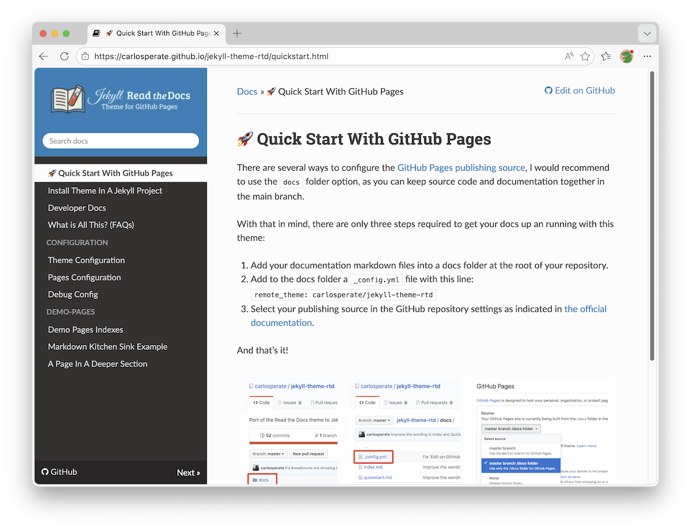

<style>
  h1 { margin-bottom: 0.2em !important; }
  h1 + p { margin-top: 0 !important; }
  h2 { margin-bottom: 0.2em !important; }
  h2 + p { margin-top: 0 !important; }
  h3 { margin-bottom: 0.2em !important; }
  h3 + p { margin-top: 0 !important; }
  h4 { margin-bottom: 0.2em !important; }
  h4 + p { margin-top: 0 !important; }
  h5 { margin-bottom: 0.2em !important; }
  h5 + p { margin-top: 0 !important; }
</style>


# Homepage
Dit is de website die ik (enigszins) up to date zal houden met alle informatie die jullie nodig hebben voor de campaign! Hou de website in de gaten voor nieuwe updates.

## Setting
De wereld is oud en magie is veel aanwezig. Er is een pantheon (zie pagina pantheon). Deze goden hebben invloed op de wereld, maar bemoeien zich liever op een indirecte manier met de wereld.
Er zijn twee soorten magische artefacten te vinden op Ardhuin:
1. Artefacten met natuurmagie.
2. Artefacten die afstammen uit een lang verloren antiek rijk. Dit antieke rijk heette Ardhuin.

Alle races en classes zijn beschikbaar, de norm is officiële D&D content, maar in overleg is homebrew ook mogelijk.

### De wereld
Drie jaar geleden is er plotseling een enorm eiland verschenen in de buurt van Dun'geal, Narrèn en Pyrhion. Al snel begon men de overeenkomsten te zien met een bijna vergeten rijk: Ardhuin. Dit rijk, wat slechts in de oudste mythen voorkomt, zou een welvarend en technologisch geavanceerd rijk zijn. Totdat het gehele eiland plotseling verdween en nooit meer terugkwam. Door de verschijning van dit eiland kwam er een tsunami die vooral Narrèn heftig raakte. Er zijn nieuwe stranden ontstaan, gebieden en zelfs steden zijn compleet verzwolgen door de oceaan. Door het zoute water dat over vele akkers ging, raakten velden verzilt. Ook werden opslagschuren en het voedsel dat op het veld stond verloren.  Veel van de akkers beginnen zich weer te herstellen, maar dit is nog niet genoeg om iedereen van te voeden. De getroffen gebieden hebben tot op heden een tekort aan eten of betalen torenhoge prijzen om genoeg voedsel te importeren.
Veel wezens vluchten naar minder heftig getroffen gebieden, zoeken hun geluk op Ardhuin, of proberen bij de Onafhankelijke Handel Federatie (OHF) hun brood te verdienen. Alle rijken, landen en grote instanties hebben hun eigen ideeën over wat ze met dit nieuw verschenen land zouden kunnen doen. Ook klinkt dit land als de perfecte plek om een nieuw leven op te bouwen. Er komen inmiddels langzaam verhalen terug van de eerste pioniers: nergens hebben ze grond gezien die zo vruchtbaar is, ook zijn er bijzondere artefacten te vinden als je je diep genoeg in de wildernis waagt. Her en der wordt er ook gesproken over de grote en gevaarlijke monsters die zich dieper landinwaarts schuil zouden houden. Maar zo erg kan het toch niet zijn? Dit zegt men vast alleen maar om anderen af te schrikken, ze willen vast het eiland voor zichzelf houden.

## Wereldkaarten

### Wereldkaart met namen


### Wereldkaart zonder namen


## Documenten
[Regels:](docs/Extra%regels.md) hier staan alle custom regels die we gebruiken.

[Verschillende rijken:](docs/Rijken.md) hier kan je informatie vinden over de verschillende rijken en gebieden.

[Pantheon:](docs/Pantheon.md) hier kan je informatie vinden over de verschillende goden in deze wereld.

[Session 0 informatie:](docs/Session%0.md) dit is de informatie die ik gegeven heb tijdens session 0. Dit bestand is niet up to date met nieuwe toevoegingen.


<!-- This is a port of the
[Read The Docs](https://sphinx-rtd-theme.readthedocs.io) theme to
[Jekyll](https://jekyllrb.com/), specifically developed be used with
[GitHub Pages](https://jekyllrb.com/docs/github-pages/).

> [!NOTE]
> You are previewing 👀 the theme right now as you navigate this documentation!



The original [Read The Docs](https://readthedocs.org)
[theme](https://sphinx-rtd-theme.readthedocs.io) was created for the
[Sphinx](https://www.sphinx-doc.org/) documentation generator, and so it is
designed specifically for docs.

Combined with [GitHub Pages](https://pages.github.com) it's a great and easy
way to document your projects!

Features:

- 🖥️ Read the Docs responsive design with a collapsible sidebar navigation
- 🐙 Specifically developed to be compatible with GitHub Pages out of the box
  - 📁 Simply create a `docs` folder with a `_config.yml` and your markdown files
  - 🔗 Automatic GitHub link, "Edit on GitHub", and commit links (optional)
  - 🏷️ Latest release tag displayed in the sidebar (optional)
- 🌐 External links in the navigation bar
- 🔍 Built-in search functionality via [Lunr.js](https://lunrjs.com/)
- 🖍️ Source code highlighting via [highlight.js](https://highlightjs.org), with a copy-to-clipboard button
- 🧜 Diagram rendering support via [Mermaid](https://www.npmjs.com/package/mermaid)
- 📢 Admonition callouts via [aDOMonitions](https://github.com/carlosperate/aDOMonitions)
- ⚓ Heading anchor links on hover via [AnchorJS](https://www.bryanbraun.com/anchorjs/)
- 🔘 Button styling via links with additional attributes
- 🏷 Labels for status, releases, or other metadata
- ⚙️ Configurable with custom options in `_config.yml` and front matter
- 📣 Social media metadata and preview images
- 🔎 SEO friendly meta tags and canonical URLs
- 🧑‍💻 TODO 🧑‍💻: 🧮 Mathematical expressions rendering

## What Can You Find Around Here

- Check out the [Quick Start Guide](quickstart.md)
  to get up and running.
- If some of the terms thrown around here don't make a lot of sense, check out
  the [What is All This? (FAQs)](faqs.md) page.
- To find out more about all the theme available options see the
  [Theme Configuration](configuration/configyml.md)
  and the [Pages Configuration](configuration/frontmatter.md)
  pages.
- The Demo Pages contain generic content to showcase how the standard Markdown
  and [additional features](configuration/markdown-extra.md)
  are rendered with this theme.
- The [Debug Config](configuration/debug.md)
  page documents a utility file you can copy into your site to inspect every
  Jekyll & Liquid variable at build time.

## 🧑‍💻 Work in Progress!

New features are still being developed but the theme is already usable and
[v1.4.0](https://github.com/carlosperate/jekyll-theme-rtd/releases/tag/v1.4.0)
is the latest release 🎉.

Any possible breaking change would be released as a major revision
(i.e. `v2`, `v3`, etc). A breaking change would be a change in existing config
options, or a significant visual style change, while new features and
settings will be released a minor revisions (i.e. `v1.1`, `v1.2`, etc).

So, it is recommended to lock the theme version in the `_config.yml` file:

```yaml
remote_theme: carlosperate/jekyll-theme-rtd@v1.4.0
```

Missing features are listed in the GitHub issues with the
[enhancement](https://github.com/carlosperate/jekyll-theme-rtd/issues?q=is%3Aissue%20state%3Aopen%20label%3Aenhancement)
or [new feature](https://github.com/carlosperate/jekyll-theme-rtd/issues?q=is%3Aissue%20state%3Aopen%20label%3A%22new%20feature%22)
labels, and any known issues are listed with the
[bug](https://github.com/carlosperate/jekyll-theme-rtd/issues?q=is%3Aissue+is%3Aopen+label%3Abug)
label.

Contributions are very welcomed! -->
